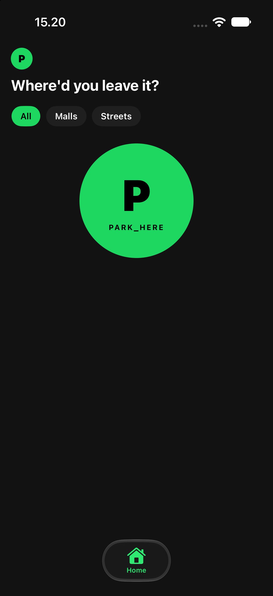

# ParkSpot

An iPhone app that saves where you parked and walks you back to it. One tap saves the spot with a photo, the app keeps sharpening the position in the background, and Find points an arrow at the car. In a multi-level garage it leads with the photo, the floor and your note instead of an arrow it cannot trust.

Private project, built from scratch in October 2026.



## What it does

- **Park here** starts location capture at the tap and opens the camera. The photo is required; the spot is stored the moment the photo exists, then keeps refining its position for up to 20 seconds or until it is accurate to 20 m.
- **Find** opens by itself while a spot is active. With a good fix it shows a compass arrow and a live distance. With a poor fix, or in a garage, it leads with the photo, the floor badge, your note and a warning that the arrow cannot be trusted.
- **Map** shows the car and you, and hands walking directions to **Google Maps** when it is installed, Apple Maps otherwise.
- **Your spots** lists every spot with search, All/Malls/Streets chips, swipe to reuse or delete, and a detail screen with the note and a small map.
- **Details** on a saved spot: floor (B3 to 2, plus more and a free-text field) and a note up to 140 characters.
- Everything is in **English and Bahasa Indonesia**, follows the phone's language, and follows Dynamic Type.

## How it is built

SwiftUI with MVVM plus Coordinators. The rules live in plain, testable value types; hardware sits behind protocols injected through `AppDependencies`, so every view model and coordinator runs against fakes.

- `Models/` — `GeoTypes`, `Geo` (distance, bearing, shortest-turn angles), `Formatting` (metric distances), `FindDisplay` (what Find shows, and why), `LocationRefiner` (which fix to keep, when to stop), `ParkingSpot` (SwiftData), `SpotFilter`.
- `Services/` — `LocationService`, `CameraAccess`, `GeocodingService`, `MapsLauncher`, `PhotoStore` + `PhotoTint`, `SpotRepository` (one active spot, rollback on a failed save), `SpotSaver` (capture at the tap, refine after).
- `Coordinators/` — `AppCoordinator` (tabs, active spot, Find cover), `SaveCoordinator` (replace check, camera, alerts), `FindCoordinator`, `HistoryCoordinator`.
- `Features/` — one folder per screen, each with its view and its `@Observable` view model.
- `UI/` — `Theme` (the only source of colour) and the shared components.

The design is dark only, Spotify-style: near-black surfaces, one accent green for actions, and the spot's own photo tinting the Find screen and the now-parked bar.

## Requirements

- Xcode 27 or newer, iOS 17.0 deployment target, iPhone, portrait.
- [XcodeGen](https://github.com/yonaskolb/XcodeGen) (`brew install xcodegen`). The `.xcodeproj` is generated from `project.yml`; never hand-edit it.
- No third-party runtime code. No server, no accounts, no analytics.

## Run it

```bash
cp Config/Signing.example.xcconfig Config/Signing.xcconfig   # set DEVELOPMENT_TEAM
xcodegen generate
open ParkSpot.xcodeproj                                       # pick your iPhone, Run
```

`Config/Signing.xcconfig` is gitignored, so a fresh clone builds in the simulator with no signing setup.

## Tests

```bash
xcodebuild test -project ParkSpot.xcodeproj -scheme ParkSpot \
  -destination 'platform=iOS Simulator,name=iPhone 17'
```

- 209 unit tests (Swift Testing) across 27 suites, including a localization guard that fails when a copy key is used but missing from the catalog.
- One end-to-end UI test (`ParkSpotUITests`) that drives Park here → details → now-parked bar → Find → Found it → the spot in Your spots, using fakes behind a `-ui-testing` launch argument.
- Green on the merged result. Two later commits — the polish pass and the Google Maps hand-off — have **not been built yet**; the first build is their test.

## Privacy

Nothing leaves the phone. No accounts, no server, no analytics. `PrivacyInfo.xcprivacy` declares no tracking and no collected data, and the app touches no required-reason APIs. Location and photos stay in the app's own storage.

## Project documents

- Product requirements: `docs/superpowers/specs/2026-10-26-parkspot-design.md`
- Implementation plan: `docs/superpowers/plans/2026-10-27-parkspot-v1.md`
- Build notes, including every deferred item and why: `docs/superpowers/plans/2026-10-27-parkspot-v1-build-notes.md`
- UI design: `design/ParkSpot UI v3.html` (v1 and v2 kept for comparison)

## Known gaps

- Not yet verified on a physical iPhone: the camera overlay, the compass, and the location callbacks on an iOS older than 27 (only the 27 runtime is installed here).
- Two deferred code items: the note's on-screen presence is pinned at the view-model level only, and the full-size photo decode for the viewer still runs on the main actor.
- No app icon variants, no TestFlight configuration, and no licence chosen yet.
